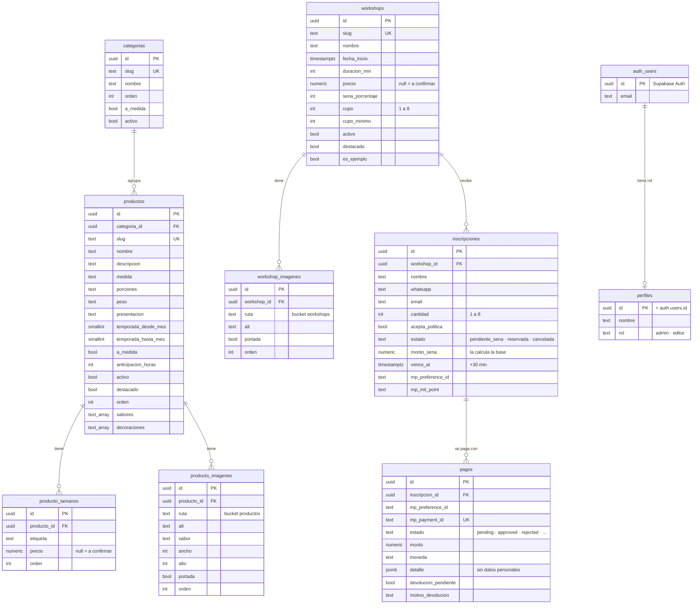

# Modelo de datos

El catálogo, los workshops y las inscripciones viven en Supabase (Postgres). El esquema está en cinco migraciones, que se corren una vez y en orden en el SQL Editor:

- [`0001_catalogo.sql`](../supabase/migrations/0001_catalogo.sql) (E4): las tablas, la lectura pública y las inscripciones.
- [`0002_auth_admin.sql`](../supabase/migrations/0002_auth_admin.sql) (E5): los perfiles con rol y los permisos de escritura de la admin. Cómo se protege el panel está en [`docs/seguridad.md`](seguridad.md).
- [`0003_pagos.sql`](../supabase/migrations/0003_pagos.sql) (E6): la tabla `pagos`, la seña y el vencimiento de las inscripciones, y `confirmar_pago`. El flujo completo está en [`docs/pagos.md`](pagos.md).
- [`0004_inscripcion_solo_servidor.sql`](../supabase/migrations/0004_inscripcion_solo_servidor.sql) (E6): `crear_inscripcion` pasa a ejecutarse solo con `service_role`, desde la API.
- [`0005_devoluciones.sql`](../supabase/migrations/0005_devoluciones.sql) (panel del E5): `devuelto_at` y `devuelto_por` en `pagos`, `marcar_devuelto` (solo la admin) y `confirmar_pago` sin volver a marcar un pago ya devuelto.

Los datos se cargan con `npm run seed` (ver el [README](../README.md#supabase)).

## Diagrama

Todas las tablas tienen `created_at` y `updated_at`; un trigger (`set_updated_at`) actualiza `updated_at` en cada cambio.

**Decisiones del esquema:**

- **Precios `numeric(12,2)` nullables:** `null` significa "Precio a confirmar". Hoy todos los precios están en `null` hasta que Maggie los confirme.
- **Borrado en cascada solo para lo que depende del producto o del workshop** (tamaños e imágenes). Una categoría con productos y un workshop con inscripciones no se pueden borrar (`on delete restrict`): una inscripción es el registro de una persona y no tiene que desaparecer por accidente.
- **Temporada como dos meses (1 a 12):** el rango puede cruzar el año (septiembre → febrero). Un check obliga a cargar los dos meses o ninguno. La web calcula si el producto está en temporada con el mes de Buenos Aires (`lib/temporada.ts`).
- **`presentacion`** guarda la caja o el pack ("Caja de 12 unidades"), que en el catálogo se llama `unidades`.
- **Una sola portada por producto o workshop:** lo garantiza un índice único parcial (`where portada`).
- **`es_ejemplo`:** los workshops de `data/workshops.ts` se cargan con `es_ejemplo = true` hasta que Maggie pase los reales. La web los muestra con el aviso "Fecha de ejemplo: todavía no hay inscripción abierta", sin botón Reservar, y `crear_inscripcion` los rechaza. Los workshops que crean los tests (slug `e2e-…`) usan `es_ejemplo = false`.

## Permisos y RLS

RLS está activado en las nueve tablas. Además, las migraciones revocan todos los privilegios de `anon` y `authenticated` y otorgan solo los que hacen falta: los permisos de la tabla deciden qué operaciones existen y las políticas, qué filas se ven o se tocan. Para la admin, las políticas exigen `(select public.es_admin())`.

| Tabla | Lectura pública (anon, authenticated) | Admin (`es_admin()`) |
|---|---|---|
| `categorias` | Solo las activas (`activo`) | Lee todas; crea, edita y borra |
| `productos` | Activos y de una categoría activa | Lee todos (también inactivos); crea, edita y borra |
| `producto_tamanos` | Los de productos activos | Lee todos; crea, edita y borra |
| `producto_imagenes` | Los de productos activos | Lee todas; crea, edita y borra |
| `workshops` | Solo los activos | Lee todos; crea, edita y borra |
| `workshop_imagenes` | Las de workshops activos | Lee todas; crea, edita y borra |
| `inscripciones` | **Ninguna:** sin permisos ni políticas | Lee todas y cambia **solo la columna `estado`**. No borra |
| `perfiles` | Cada usuaria lee **solo su** perfil | Igual: nadie escribe con la clave publishable |
| `pagos` | **Ninguna** | Lee todos. No escribe directamente: solo puede marcar una devolución con `marcar_devuelto`. El resto lo escribe `confirmar_pago` (service_role) |

Las políticas permisivas se combinan con OR: la admin ve lo activo por la política pública y lo inactivo por la suya.

### Permisos por rol

| Puede… | Visitante (anon) | Con sesión, sin rol | `editor` | `admin` | `service_role` (secret key) |
|---|---|---|---|---|---|
| Ver el catálogo y los workshops activos | ✓ | ✓ | ✓ | ✓ | ✓ |
| Inscribirse (por `POST /api/v1/inscripciones`) | ✓ | ✓ | ✓ | ✓ | — |
| Llamar directo a `crear_inscripcion` | ✗ | ✗ | ✗ | ✗ | ✓ (solo la API, desde la 0004) |
| Entrar a `/admin` y a `/api/v1/admin` | ✗ (login / 401) | ✗ (403) | ✗ (403) | ✓ | — |
| Ver lo inactivo | ✗ | ✗ | ✗ | ✓ | ✓ |
| Crear, editar y borrar productos, categorías y workshops | ✗ | ✗ | ✗ | ✓ | ✓ |
| Subir y borrar fotos en Storage | ✗ | ✗ | ✗ | ✓ | ✓ |
| Ver inscripciones (datos personales) | ✗ | ✗ | ✗ | ✓ | ✓ |
| Ver los pagos | ✗ | ✗ | ✗ | ✓ | ✓ |
| Registrar un pago y reservar (`confirmar_pago`) | ✗ | ✗ | ✗ | ✗ | ✓ (webhook y conciliación) |
| Marcar un pago como devuelto (`marcar_devuelto`) | ✗ | ✗ | ✗ | ✓ | — |
| Cambiar el estado de una inscripción | ✗ | ✗ | ✗ | ✓ | ✓ |
| Borrar inscripciones | ✗ | ✗ | ✗ | ✗ | ✓ |
| Asignar roles (`perfiles`) | ✗ | ✗ | ✗ | ✗ | ✓ (o SQL en el dashboard) |

`editor` está reservado: hoy tiene los mismos permisos que una cuenta sin rol. `service_role` se saltea RLS; solo lo usan el seed y los tests, nunca la web.

### Funciones y vistas

- **`workshops_publicos`** es una vista con `security_invoker = true`: corre con los permisos de quien consulta, así que respeta el RLS de `workshops` (solo activos). Además filtra los que ya empezaron y calcula `lugares_libres`.
- **`lugares_ocupados(workshop_id)`** es `security definer`: anon no puede leer `inscripciones`, así que la vista no podría sumar los lugares ocupados. La función solo devuelve el total de lugares, nunca datos de las personas. Desde la 0003 cuenta las **reservadas** y las **pendientes de seña que no vencieron** (`vence_at > now()`). Una pendiente vencida libera el cupo sola, sin un proceso que la cancele.
- **`confirmar_pago(inscripción, pago, estado, monto, moneda, detalle)`** (0003) es `security definer` y **solo la ejecuta `service_role`**. Registra el pago de MP de forma idempotente y reserva si corresponde. Ver [pagos.md](pagos.md#qué-hace-confirmar_pago).
- **`es_admin()`** (0002) es `security definer`, `stable`, con `search_path = ''`. Lee `perfiles` y devuelve si la usuaria actual (`auth.uid()`) es admin. Solo la puede ejecutar `authenticated`.
- **`cambiar_estado_inscripcion(id, estado)`** (0002) es `security invoker`: corre con el RLS de la admin. Bloquea la inscripción y el workshop (como `crear_inscripcion`) y, si una cancelada vuelve a estar activa y ya no hay lugar, falla con `HB409`. Así el panel no puede sobrevender.
- **`reemplazar_tamanos(producto_id, tamanos)`** (0002) es `security invoker`. Borra los tamaños de un producto e inserta los nuevos en una sola transacción: si algo falla, quedan los de antes.
- **`service_role` (la secret key)** se saltea RLS y la usan el seed y los tests. El proyecto tiene desactivado "Automatically expose new tables", así que la migración 0001 le otorga permisos explícitos (`grant all on all tables…`, `grant execute on all functions…`) y los mismos por defecto (`alter default privileges`), que cubren lo que crea la 0002.
- **Storage:** los buckets `productos` y `workshops` son públicos, así que las fotos se sirven por URL sin pasar por RLS. Subir, reemplazar y borrar en esos buckets pide `es_admin()` (políticas sobre `storage.objects`).

## Por qué la inscripción va por una función

Reservar un lugar son dos pasos: **mirar cuántos lugares quedan** y **guardar la inscripción**. Si se hacen por separado (por ejemplo, un `select` desde la API y después un `insert`), dos personas que se inscriben a la vez pueden leer los mismos lugares libres y entrar las dos:

| Momento | Persona A | Persona B |
|---|---|---|
| 1 | Lee: quedan 2 lugares | |
| 2 | | Lee: quedan 2 lugares |
| 3 | Guarda 2 lugares | |
| 4 | | Guarda 2 lugares → **4 lugares vendidos de 2** |

`crear_inscripcion(...)` hace los dos pasos dentro de **una sola transacción** en la base:

1. **Bloquea la fila del workshop** con `select … for update`. Si otra inscripción al mismo workshop está en curso, esta espera a que termine. Así, en el ejemplo, B lee los lugares recién después de que A guardó, y ve 0.
2. **Valida:**
   - que el workshop exista, esté activo, no sea de ejemplo y no haya empezado (si no, `HB404`);
   - que tenga precio (si no, `HB422`);
   - que alcancen los lugares (si no, `HB409`, con los lugares libres en `detail`).
3. **Calcula la seña** (`precio × cantidad × sena_porcentaje / 100`, al centavo) e **inserta** la inscripción pendiente, que vence en 30 minutos. Devuelve el id, la seña y el vencimiento. Los checks de la tabla validan nombre, WhatsApp, email, cantidad (1 a 8) y aceptación de la política; si alguno falla, `23514`.

Es ACID:
- **Atómica:** o se guarda todo o nada.
- **Consistente:** los checks y el cupo se cumplen siempre.
- **Aislada:** el bloqueo atiende de a una las inscripciones a un mismo workshop.
- **Durable:** una vez confirmada, queda guardada.

El test `no sobrevende con inscripciones simultáneas` (`e2e/api.spec.ts`) manda diez inscripciones de 2 lugares a la vez a un workshop con cupo 3: entra una sola.

La función es `security definer` (corre con los permisos de su dueño) para poder insertar en `inscripciones`, que nadie más que la admin puede leer. Desde la 0004 solo la ejecuta `service_role`: la llama `POST /api/v1/inscripciones` con la secret key, después de validar el pedido y el rate limit. Lleva `set search_path = ''` y nombra todo con su schema (`public.workshops`), para que nadie pueda colar una tabla o función con el mismo nombre en otro schema.

**Errores y cómo los traduce la API (`POST /api/v1/inscripciones`):**

| Código | Cuándo | Respuesta |
|---|---|---|
| `HB404` | No existe, inactivo, de ejemplo o ya empezó | 404 |
| `HB409` | No alcanza el cupo (`detail` = lugares libres) | 409 con `spotsLeft` |
| `HB422` | El workshop no tiene precio | 422 "Precio a confirmar, consultanos por WhatsApp." |
| `23514`, `22xxx` | No pasa un check de la tabla | 400 |
| Otro | Error inesperado | 500 (se registra solo el código, sin datos personales) |

### Riesgo cerrado: la función se podía ejecutar con la clave publishable

**Hasta el E6**, `crear_inscripcion` tenía `grant execute` para `anon` y `authenticated`. Cualquiera con la clave publishable, que es pública porque viaja al navegador, podía llamarla directo por la API de Supabase, sin pasar por el formulario ni por la API. Era una decisión consciente del E4 y estaba documentada.

- **Riesgo:** inscripciones falsas que ocupaban el cupo, sin rate limit y (desde el E6) sin preferencia de pago.
- **Mitigación en el E4 y el E5:** los checks de la tabla, 8 lugares como máximo, los workshops de ejemplo sin inscripción, y que la admin pueda cancelar.

**Desde la migración 0004 el riesgo está cerrado:**
- `crear_inscripcion` solo la ejecuta `service_role`;
- la única puerta es `POST /api/v1/inscripciones`, que valida con zod, aplica el rate limit (5 por IP cada 10 minutos, `TODO(Redis)`) y crea la preferencia de pago;
- una inscripción sin pago vence a los 30 minutos y libera el cupo sola.

Lo prueba el e2e "con la clave publishable no se puede llamar a crear_inscripcion": responde `42501` y no ocupa lugar.

- **Pendiente:** TODO captcha en el formulario, si el rate limit no alcanza.

## Caché

Las páginas públicas (`/`, `/tienda`, `/tienda/[slug]` y `/workshops`) son estáticas con ISR, y se regeneran de dos formas:

- **On-demand:** cada cambio desde el panel llama a `revalidatePath` (`lib/admin/revalidar.ts`):
  - un producto revalida `/`, `/tienda` y `/tienda/<slug>`;
  - un workshop o el estado de una inscripción revalida `/` y `/workshops`;
  - una inscripción nueva desde el sitio también revalida `/` y `/workshops`, porque cambian los lugares libres.
- **Cada 5 minutos** (`export const revalidate = 300`): queda como red de seguridad para lo que cambia solo, como la temporada (depende del mes) o los workshops que ya empezaron.

La inscripción lee los lugares libres en cada request. La API pública responde con `Cache-Control: public, s-maxage=300, stale-while-revalidate=600`. La de admin y los errores llevan `no-store`.
