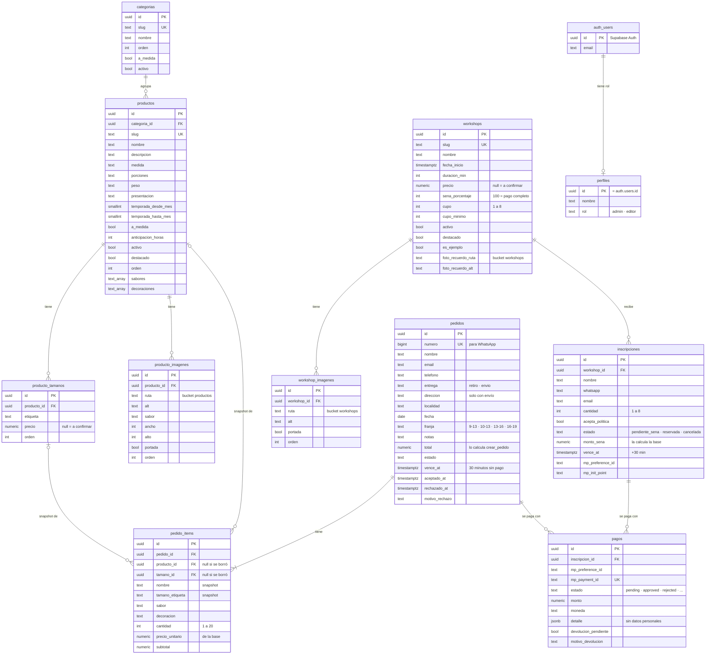
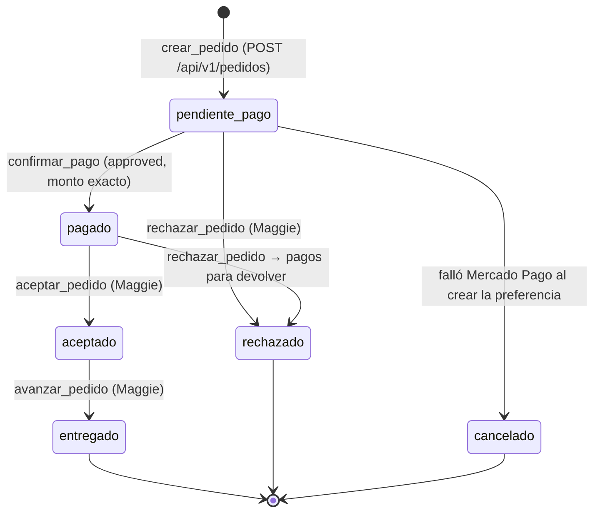
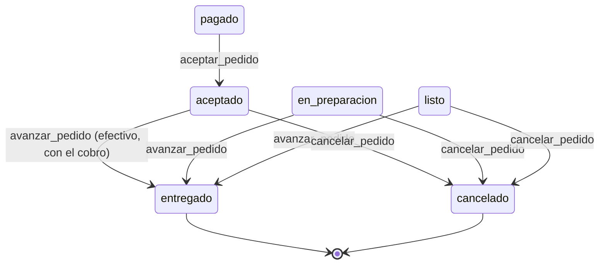
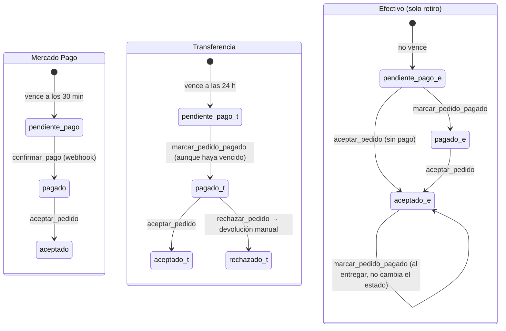

# Modelo de datos

El catálogo, los workshops, las inscripciones y los pedidos de la tienda viven en Supabase (Postgres). El esquema está en diez migraciones, que se corren una vez y en orden en el SQL Editor:

- [`0001_catalogo.sql`](../supabase/migrations/0001_catalogo.sql) (E4): las tablas, la lectura pública y las inscripciones.
- [`0002_auth_admin.sql`](../supabase/migrations/0002_auth_admin.sql) (E5): los perfiles con rol y los permisos de escritura de la admin. Cómo se protege el panel está en [`docs/seguridad.md`](seguridad.md).
- [`0003_pagos.sql`](../supabase/migrations/0003_pagos.sql) (E6): la tabla `pagos`, la seña y el vencimiento de las inscripciones, y `confirmar_pago`. El flujo completo está en [`docs/pagos.md`](pagos.md).
- [`0004_inscripcion_solo_servidor.sql`](../supabase/migrations/0004_inscripcion_solo_servidor.sql) (E6): `crear_inscripcion` pasa a ejecutarse solo con `service_role`, desde la API.
- [`0005_devoluciones.sql`](../supabase/migrations/0005_devoluciones.sql) (panel del E5): `devuelto_at` y `devuelto_por` en `pagos`, `marcar_devuelto` (solo la admin) y `confirmar_pago` sin volver a marcar un pago ya devuelto.
- [`0006_pago_completo.sql`](../supabase/migrations/0006_pago_completo.sql): pago completo al inscribirse. `sena_porcentaje` pasa a 100 (default y workshops existentes); los nombres internos no cambian. Ver [pagos.md](pagos.md#pago-completo-migración-0006).
- [`0007_pedidos.sql`](../supabase/migrations/0007_pedidos.sql): los pedidos de la tienda.
  - Tablas `pedidos` y `pedido_items`.
  - `crear_pedido` (solo `service_role`).
  - `pagos` pasa a ser de una inscripción **o** de un pedido, con `confirmar_pago(tipo, id, …)`.
  - `aceptar_pedido` y `rechazar_pedido` (solo admin).

  Ver [Estados de un pedido](#estados-de-un-pedido) y [pagos.md](pagos.md#pedidos-de-la-tienda-migración-0007).
- [`0008_medios_de_pago.sql`](../supabase/migrations/0008_medios_de_pago.sql): medios de pago de los pedidos.
  - `pedidos.medio_pago` (`mercadopago`, `transferencia`, `efectivo`), con checks: efectivo solo con retiro, y `vence_at` nulo solo con efectivo.
  - `pagado_at` / `pagado_por` (pago marcado a mano) y `devolucion_pendiente` / `devuelto_at` / `devuelto_por` (devolución manual).
  - `crear_pedido` recibe `p_medio_pago`.
  - `marcar_pedido_pagado` y `marcar_pedido_devuelto` (solo admin); `aceptar_pedido` y `rechazar_pedido` según el medio.

  Ver [Estados por medio de pago](#estados-por-medio-de-pago) y [pagos.md](pagos.md#medios-de-pago-migración-0008).
- [`0009_avanzar_pedido.sql`](../supabase/migrations/0009_avanzar_pedido.sql): el panel de pedidos.
  - `en_preparacion_at`, `listo_at`, `entregado_at`, `cancelado_at` y `motivo_cancelacion` en `pedidos`.
  - `avanzar_pedido` y `cancelar_pedido` (solo admin).

  Ver [Transiciones de un pedido](#transiciones-de-un-pedido).
- [`0010_workshops_pasados.sql`](../supabase/migrations/0010_workshops_pasados.sql): "Así fueron los workshops" desde la base.
  - `foto_recuerdo_ruta` y `foto_recuerdo_alt` en `workshops` (la foto de cómo fue).
  - `poner_foto_recuerdo` y `quitar_foto_recuerdo` (solo admin) y `workshops_pasados(limite)` (lectura pública).
  - Carga los 9 workshops que ya se hicieron (antes en `data/site.ts`).

  Ver [Foto de cómo fue](#foto-de-cómo-fue).
- [`0011_pedidos_simples.sql`](../supabase/migrations/0011_pedidos_simples.sql): un pedido en curso se entrega en un paso.
  - `avanzar_pedido` acepta `entregado` desde `aceptado`, `en_preparacion` o `listo`.
  - No cambia el check de `pedidos.estado` ni `cancelar_pedido`.

  Ver [Transiciones de un pedido](#transiciones-de-un-pedido).

Los datos se cargan con `npm run seed` (ver el [README](../README.md#supabase)).

## Diagrama

En `pagos`, `inscripcion_id` y `pedido_id` son los dos opcionales, pero un check (`num_nonnulls(...) = 1`) exige exactamente uno.

### Estados de un pedido

Pagar **no confirma** el pedido: lo confirma Maggie.

- Un `pendiente_pago` vencido (pasaron los 30 minutos) sigue en ese estado: no ocupa nada. Si igual llega un pago aprobado por el total, pasa a `pagado`.
- `aceptado → entregado` lo mueve el panel con `avanzar_pedido` (0011). Ver [Transiciones de un pedido](#transiciones-de-un-pedido).
- Un pago aprobado de un pedido `rechazado` o `cancelado`, con otro monto, o un segundo pago del mismo pedido, queda **para devolver** ([pagos.md](pagos.md#pedidos-de-la-tienda-migración-0007)).

### Transiciones de un pedido

Todas son funciones `security definer` que chequean `es_admin()` adentro (42501) y bloquean el pedido (`for update`). Lo que no está en la tabla, la base lo rechaza con `HB409`.

| Desde | Hacia | Función | Condición |
|---|---|---|---|
| `pendiente_pago` | `pagado` | `confirmar_pago` (webhook) o `marcar_pedido_pagado` | MP: monto exacto. Transferencia: aunque haya vencido. Efectivo: guarda el cobro |
| `pagado` | `aceptado` | `aceptar_pedido` | — |
| `pendiente_pago` (efectivo) | `aceptado` | `aceptar_pedido` | Sin pago: se cobra al retirar |
| `pendiente_pago` o `pagado` | `rechazado` | `rechazar_pedido` | Con pago → para devolver |
| `aceptado`, `en_preparacion` o `listo` | `entregado` | `avanzar_pedido` | Efectivo sin cobrar: `p_cobrado = true`, que guarda el cobro en el mismo paso |
| `aceptado` → `en_preparacion` → `listo` | — | `avanzar_pedido` | Legado (0009): la base los sigue aceptando de a un paso, pero el panel ya no los ofrece |
| `aceptado`, `en_preparacion` o `listo` | `cancelado` | `cancelar_pedido` | Motivo obligatorio (3 a 500 caracteres, si no 22023). Con pago → para devolver (`pedido_cancelado`) |

- **En curso se entrega en un paso (0011):** el panel muestra "En curso" para `aceptado`, `en_preparacion` y `listo`, y solo ofrece **Entregado** (o **Cancelar pedido**). Desde otro estado → `HB409`; un estado que no es `en_preparacion`, `listo` ni `entregado` → `22023`.
- **`en_preparacion` y `listo` quedan en el check** de `pedidos.estado` por los pedidos que ya están así (de antes de 0011). `avanzar_pedido` todavía acepta `aceptado → en_preparacion → listo` de a un paso, para que el código deployado antes de correr la 0011 no falle; el panel ya no lo usa. "Avisar que está listo" abre WhatsApp y no cambia el estado.
- **Cada paso guarda su fecha** (`aceptado_at`, `en_preparacion_at`, `listo_at`, `entregado_at`, `rechazado_at`, `cancelado_at`): el panel arma el historial con eso, los pagos y `pagado_at` / `devuelto_at`.

### Estados por medio de pago

En los tres medios Maggie tiene que **aceptar** el pedido, y el total es el mismo (sin descuentos).

(Los sufijos `_t` y `_e` son solo para el diagrama: los estados se llaman igual en los tres medios.)

- **Vencer no cambia el estado:** un `pendiente_pago` con `vence_at` pasado se lee como vencido, igual que una inscripción. La clienta lo ve vencido y no puede seguir con ese pedido. La admin igual puede registrar una transferencia vencida, porque la plata puede llegar tarde, y después decide si lo acepta.
- **Mercado Pago no se marca a mano:** `marcar_pedido_pagado` responde `HB409`.
- **Aceptar:** un pedido `pagado`, o uno en efectivo en `pendiente_pago`. Una transferencia o un MP sin pagar, no.
- **Rechazar con un pago marcado a mano** (`pagado_at`) deja el pedido con `devolucion_pendiente`. La admin lo cierra con `marcar_pedido_devuelto`. Las devoluciones de MP siguen en `pagos`.

Todas las tablas tienen `created_at` y `updated_at`; un trigger (`set_updated_at`) actualiza `updated_at` en cada cambio.

**Decisiones del esquema:**

- **Precios `numeric(12,2)` nullables:** `null` significa "Precio a confirmar". Hoy todos los precios están en `null` hasta que Maggie los confirme.
- **Borrado en cascada solo para lo que depende del producto o del workshop** (tamaños e imágenes). Una categoría con productos y un workshop con inscripciones no se pueden borrar (`on delete restrict`): una inscripción es el registro de una persona y no tiene que desaparecer por accidente.
- **Temporada como dos meses (1 a 12):** el rango puede cruzar el año (septiembre → febrero). Un check obliga a cargar los dos meses o ninguno. La web calcula si el producto está en temporada con el mes de Buenos Aires (`lib/temporada.ts`).
- **`presentacion`** guarda la caja o el pack ("Caja de 12 unidades"), que en el catálogo se llama `unidades`.
- **Una sola portada por producto o workshop:** lo garantiza un índice único parcial (`where portada`).
- **`es_ejemplo`:** los workshops de `data/workshops.ts` se cargan con `es_ejemplo = true` hasta que Maggie pase los reales. La web los muestra con el aviso "Fecha de ejemplo: todavía no hay inscripción abierta", sin botón Reservar, y `crear_inscripcion` los rechaza. Los workshops que crean los tests (slug `e2e-…`) usan `es_ejemplo = false`.

### Foto de cómo fue

"Así fueron los workshops" (en `/workshops`) muestra los workshops que ya se hicieron. Sale de la tabla `workshops`: después de cada workshop, Maggie sube desde el panel una **foto de cómo fue** y el workshop aparece solo en la sección.

- **Dos columnas en `workshops`** (`foto_recuerdo_ruta`, `foto_recuerdo_alt`) y no un tipo nuevo en `workshop_imagenes`. Es una sola foto por workshop y la estructura ya lo asegura. Además, las fotos de promoción quedan como estaban: portada, orden, la política pública (solo workshops activos, y los pasados suelen estar inactivos) y la API de fotos. Un check obliga a cargar la ruta y el alt juntos, con un alt de 1 a 200 caracteres. El archivo va al bucket `workshops`, en la carpeta del slug (`<slug>/recuerdo-<uuid>.webp`).
- **`poner_foto_recuerdo(workshop_id, ruta, alt)` / `quitar_foto_recuerdo(workshop_id)`:** `security definer` con `es_admin()` adentro (`42501`). Si el workshop no existe, `HB404`. `poner_foto_recuerdo` solo acepta un workshop que **ya pasó y no es de ejemplo** (si no, `HB409`). Las dos devuelven la ruta anterior, así el servidor borra ese archivo.
- **`workshops_pasados(limite)`:** la lectura pública. Es `security definer` porque anon no ve los workshops inactivos, y devuelve **solo** `nombre`, `fecha_inicio`, `foto_ruta` y `foto_alt`: nada de inscripciones, precios ni cupo. Filtra `fecha_inicio < now()`, `not es_ejemplo` y con foto, del más reciente al más viejo (y por nombre, si dos tienen la misma fecha), con un tope de 50. El sitio pide los últimos 9 (`pages.workshops.past.max` en `data/site.ts`). Es una función y no una vista `security definer`, que el linter de Supabase marca como riesgo.
- **Los 9 de `data/site.ts`** se cargaron en la 0010 como pasados: `activo = false`, `es_ejemplo = false`, sin precio, el día 15 del mes (fechas aproximadas: [contenido-maggie.md](contenido-maggie.md)). Los slugs llevan el mes (`postres-en-shot-2026-10`), así no chocan si Maggie repite un workshop. El insert es idempotente (`on conflict (slug) do nothing`). `cupo` y `cupo_minimo` quedan en el default, porque la tabla no los deja en null; igual no se venden, porque `crear_inscripcion` rechaza los inactivos y los que ya empezaron.

## Permisos y RLS

RLS está activado en las once tablas. Además, las migraciones revocan todos los privilegios de `anon` y `authenticated` y otorgan solo los que hacen falta: los permisos de la tabla deciden qué operaciones existen y las políticas, qué filas se ven o se tocan. Para la admin, las políticas exigen `(select public.es_admin())`.

| Tabla | Lectura pública (anon, authenticated) | Admin (`es_admin()`) |
|---|---|---|
| `categorias` | Solo las activas (`activo`) | Lee todas; crea, edita y borra |
| `productos` | Activos y de una categoría activa | Lee todos (también inactivos); crea, edita y borra |
| `producto_tamanos` | Los de productos activos | Lee todos; crea, edita y borra |
| `producto_imagenes` | Los de productos activos | Lee todas; crea, edita y borra |
| `workshops` | Solo los activos. Los pasados con foto, solo por `workshops_pasados` (nombre, fecha y foto) | Lee todos; crea, edita y borra. La foto de cómo fue, con `poner_foto_recuerdo` / `quitar_foto_recuerdo` |
| `workshop_imagenes` | Las de workshops activos | Lee todas; crea, edita y borra |
| `inscripciones` | **Ninguna:** sin permisos ni políticas | Lee todas y cambia **solo la columna `estado`**. No borra |
| `perfiles` | Cada usuaria lee **solo su** perfil | Igual: nadie escribe con la clave publishable |
| `pagos` | **Ninguna** | Lee todos. No escribe directamente: solo puede marcar una devolución con `marcar_devuelto`. El resto lo escribe `confirmar_pago` (service_role) |
| `pedidos`, `pedido_items` | **Ninguna:** tienen datos personales | Los lee. No escribe directamente: acepta o rechaza con `aceptar_pedido` / `rechazar_pedido`. Los crea `crear_pedido` (service_role) |

Las políticas permisivas se combinan con OR: la admin ve lo activo por la política pública y lo inactivo por la suya.

### Permisos por rol

| Puede… | Visitante (anon) | Con sesión, sin rol | `editor` | `admin` | `service_role` (secret key) |
|---|---|---|---|---|---|
| Ver el catálogo y los workshops activos | ✓ | ✓ | ✓ | ✓ | ✓ |
| Ver los workshops pasados con foto (`workshops_pasados`) | ✓ | ✓ | ✓ | ✓ | ✓ |
| Subir o quitar la foto de cómo fue (`poner_foto_recuerdo`, `quitar_foto_recuerdo`) | ✗ | ✗ | ✗ | ✓ | — |
| Inscribirse (por `POST /api/v1/inscripciones`) | ✓ | ✓ | ✓ | ✓ | — |
| Hacer un pedido (por `POST /api/v1/pedidos`) | ✓ | ✓ | ✓ | ✓ | — |
| Llamar directo a `crear_pedido` | ✗ | ✗ | ✗ | ✗ | ✓ (solo la API) |
| Ver pedidos | ✗ | ✗ | ✗ | ✓ | ✓ |
| Aceptar o rechazar un pedido | ✗ | ✗ | ✗ | ✓ | — |
| Marcar pagado un pedido por transferencia o efectivo (`marcar_pedido_pagado`) | ✗ | ✗ | ✗ | ✓ | — |
| Marcar devuelto un pedido (`marcar_pedido_devuelto`) | ✗ | ✗ | ✗ | ✓ | — |
| Avanzar o cancelar un pedido aceptado (`avanzar_pedido`, `cancelar_pedido`) | ✗ | ✗ | ✗ | ✓ | — |
| Llamar directo a `crear_inscripcion` | ✗ | ✗ | ✗ | ✗ | ✓ (solo la API, desde la 0004) |
| Entrar a `/admin` y a `/api/v1/admin` | ✗ (login / 401) | ✗ (403) | ✗ (403) | ✓ | — |
| Ver lo inactivo | ✗ | ✗ | ✗ | ✓ | ✓ |
| Crear, editar y borrar productos, categorías y workshops | ✗ | ✗ | ✗ | ✓ | ✓ |
| Subir y borrar fotos en Storage | ✗ | ✗ | ✗ | ✓ | ✓ |
| Ver inscripciones (datos personales) | ✗ | ✗ | ✗ | ✓ | ✓ |
| Ver los pagos | ✗ | ✗ | ✗ | ✓ | ✓ |
| Registrar un pago y reservar (`confirmar_pago`) | ✗ | ✗ | ✗ | ✗ | ✓ (webhook y conciliación) |
| Marcar un pago como devuelto (`marcar_devuelto`) | ✗ | ✗ | ✗ | ✓ | — |
| Cambiar el estado de una inscripción | ✗ | ✗ | ✗ | ✓ | ✓ |
| Borrar inscripciones | ✗ | ✗ | ✗ | ✗ | ✓ |
| Asignar roles (`perfiles`) | ✗ | ✗ | ✗ | ✗ | ✓ (o SQL en el dashboard) |

`editor` está reservado: hoy tiene los mismos permisos que una cuenta sin rol. `service_role` se saltea RLS; solo lo usan el seed y los tests, nunca la web.

### Funciones y vistas

- **`workshops_publicos`** es una vista con `security_invoker = true`: corre con los permisos de quien consulta, así que respeta el RLS de `workshops` (solo activos). Además filtra los que ya empezaron y calcula `lugares_libres`.
- **`lugares_ocupados(workshop_id)`** es `security definer`: anon no puede leer `inscripciones`, así que la vista no podría sumar los lugares ocupados. La función solo devuelve el total de lugares, nunca datos de las personas. Desde la 0003 cuenta las **reservadas** y las **pendientes de seña que no vencieron** (`vence_at > now()`). Una pendiente vencida libera el cupo sola, sin un proceso que la cancele.
- **`confirmar_pago(tipo, id, pago, estado, monto, moneda, detalle)`** (0007, reemplaza la de 0003/0005) es `security definer` y **solo la ejecuta `service_role`**. Registra el pago de MP de forma idempotente. Si es de una inscripción, reserva si corresponde; si es de un pedido, lo pasa a `pagado`. La firma vieja, solo para inscripciones, queda como envoltorio. Ver [pagos.md](pagos.md#qué-hace-confirmar_pago).
- **`crear_pedido(…)`** (0007) es `security definer` y solo la ejecuta `service_role`. Valida y recalcula todo el pedido desde la base. Con un error de negocio responde `HB422`, con el campo en el `hint`, y la API lo devuelve como 400 en ese campo.
- **`aceptar_pedido(id)` / `rechazar_pedido(id, motivo)`** (0007, ajustadas en la 0008 según el medio de pago) son `security definer` y chequean `es_admin()` adentro, como `marcar_devuelto`. Bloquean el pedido (`for update`), así un webhook que llega a la vez ve el estado nuevo.
- **`marcar_pedido_pagado(id)` / `marcar_pedido_devuelto(id)`** (0008): igual, `security definer` con `es_admin()` adentro. Guardan quién y cuándo (`pagado_por`, `devuelto_por`).
- **`avanzar_pedido(id, estado, cobrado)` / `cancelar_pedido(id, motivo)`** (0009): igual. Ver [Transiciones de un pedido](#transiciones-de-un-pedido).
- **`workshops_pasados(limite)`** (0010) es `security definer` y la ejecutan anon y authenticated: devuelve solo nombre, fecha y foto de los pasados con foto. **`poner_foto_recuerdo` / `quitar_foto_recuerdo`** (0010): `security definer` con `es_admin()` adentro. Ver [Foto de cómo fue](#foto-de-cómo-fue).
- **`es_admin()`** (0002) es `security definer`, `stable`, con `search_path = ''`. Lee `perfiles` y devuelve si la usuaria actual (`auth.uid()`) es admin. Solo la puede ejecutar `authenticated`.
- **`cambiar_estado_inscripcion(id, estado)`** (0002) es `security invoker`: corre con el RLS de la admin. Bloquea la inscripción y el workshop (como `crear_inscripcion`) y, si una cancelada vuelve a estar activa y ya no hay lugar, falla con `HB409`. Así el panel no puede sobrevender.
- **`reemplazar_tamanos(producto_id, tamanos)`** (0002) es `security invoker`. Borra los tamaños de un producto e inserta los nuevos en una sola transacción: si algo falla, quedan los de antes.
- **`service_role` (la secret key)** se saltea RLS y la usan el seed y los tests. El proyecto tiene desactivado "Automatically expose new tables", así que la migración 0001 le otorga permisos explícitos (`grant all on all tables…`, `grant execute on all functions…`) y los mismos por defecto (`alter default privileges`), que cubren lo que crea la 0002.
- **Storage:** los buckets `productos` y `workshops` son públicos, así que las fotos se sirven por URL sin pasar por RLS. Subir, reemplazar y borrar en esos buckets pide `es_admin()` (políticas sobre `storage.objects`).

## Por qué la inscripción va por una función

Reservar un lugar son dos pasos: **mirar cuántos lugares quedan** y **guardar la inscripción**. Si se hacen por separado (por ejemplo, un `select` desde la API y después un `insert`), dos personas que se inscriben a la vez pueden leer los mismos lugares libres y entrar las dos:

| Momento | Persona A | Persona B |
|---|---|---|
| 1 | Lee: quedan 2 lugares | |
| 2 | | Lee: quedan 2 lugares |
| 3 | Guarda 2 lugares | |
| 4 | | Guarda 2 lugares → **4 lugares vendidos de 2** |

`crear_inscripcion(...)` hace los dos pasos dentro de **una sola transacción** en la base:

1. **Bloquea la fila del workshop** con `select … for update`. Si otra inscripción al mismo workshop está en curso, esta espera a que termine. Así, en el ejemplo, B lee los lugares recién después de que A guardó, y ve 0.
2. **Valida:**
   - que el workshop exista, esté activo, no sea de ejemplo y no haya empezado (si no, `HB404`);
   - que tenga precio (si no, `HB422`);
   - que alcancen los lugares (si no, `HB409`, con los lugares libres en `detail`).
3. **Calcula el monto** (`precio × cantidad × sena_porcentaje / 100`, al centavo; con el 100% de la 0006, el total) e **inserta** la inscripción pendiente, que vence en 30 minutos. Devuelve el id, el monto y el vencimiento. Los checks de la tabla validan nombre, WhatsApp, email, cantidad (1 a 8) y aceptación de la política; si alguno falla, `23514`.

Es ACID:
- **Atómica:** o se guarda todo o nada.
- **Consistente:** los checks y el cupo se cumplen siempre.
- **Aislada:** el bloqueo atiende de a una las inscripciones a un mismo workshop.
- **Durable:** una vez confirmada, queda guardada.

El test `no sobrevende con inscripciones simultáneas` (`e2e/api.spec.ts`) manda diez inscripciones de 2 lugares a la vez a un workshop con cupo 3: entra una sola.

La función es `security definer` (corre con los permisos de su dueño) para poder insertar en `inscripciones`, que nadie más que la admin puede leer. Desde la 0004 solo la ejecuta `service_role`: la llama `POST /api/v1/inscripciones` con la secret key, después de validar el pedido y el rate limit. Lleva `set search_path = ''` y nombra todo con su schema (`public.workshops`), para que nadie pueda colar una tabla o función con el mismo nombre en otro schema.

**Errores y cómo los traduce la API (`POST /api/v1/inscripciones`):**

| Código | Cuándo | Respuesta |
|---|---|---|
| `HB404` | No existe, inactivo, de ejemplo o ya empezó | 404 |
| `HB409` | No alcanza el cupo (`detail` = lugares libres) | 409 con `spotsLeft` |
| `HB422` | El workshop no tiene precio | 422 "Precio a confirmar, consultanos por WhatsApp." |
| `23514`, `22xxx` | No pasa un check de la tabla | 400 |
| Otro | Error inesperado | 500 (se registra solo el código, sin datos personales) |

### Riesgo cerrado: la función se podía ejecutar con la clave publishable

**Hasta el E6**, `crear_inscripcion` tenía `grant execute` para `anon` y `authenticated`. Cualquiera con la clave publishable, que es pública porque viaja al navegador, podía llamarla directo por la API de Supabase, sin pasar por el formulario ni por la API. Era una decisión consciente del E4 y estaba documentada.

- **Riesgo:** inscripciones falsas que ocupaban el cupo, sin rate limit y (desde el E6) sin preferencia de pago.
- **Mitigación en el E4 y el E5:** los checks de la tabla, 8 lugares como máximo, los workshops de ejemplo sin inscripción, y que la admin pueda cancelar.

**Desde la migración 0004 el riesgo está cerrado:**
- `crear_inscripcion` solo la ejecuta `service_role`;
- la única puerta es `POST /api/v1/inscripciones`, que valida con zod, aplica el rate limit (5 por IP cada 10 minutos, `TODO(Redis)`) y crea la preferencia de pago;
- una inscripción sin pago vence a los 30 minutos y libera el cupo sola.

Lo prueba el e2e "con la clave publishable no se puede llamar a crear_inscripcion": responde `42501` y no ocupa lugar.

- **Pendiente:** TODO captcha en el formulario, si el rate limit no alcanza.

## Caché

Las páginas públicas (`/`, `/tienda`, `/tienda/[slug]` y `/workshops`) son estáticas con ISR, y se regeneran de dos formas:

- **On-demand:** cada cambio desde el panel llama a `revalidatePath` (`lib/admin/revalidar.ts`):
  - un producto revalida `/`, `/tienda` y `/tienda/<slug>`;
  - un workshop, su foto de cómo fue o el estado de una inscripción revalida `/` y `/workshops`;
  - una inscripción nueva desde el sitio también revalida `/` y `/workshops`, porque cambian los lugares libres.
- **Cada 5 minutos** (`export const revalidate = 300`): queda como red de seguridad para lo que cambia solo, como la temporada (depende del mes) o los workshops que ya empezaron.

La inscripción lee los lugares libres en cada request. La API pública responde con `Cache-Control: public, s-maxage=300, stale-while-revalidate=600`. La de admin y los errores llevan `no-store`.
