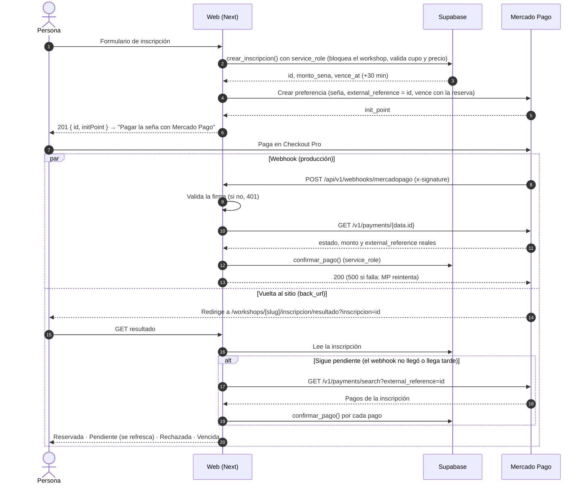

# Pagos: seña de los workshops con Mercado Pago

La seña de un workshop se paga con **Mercado Pago Checkout Pro**. El esquema está en [`supabase/migrations/0003_pagos.sql`](../supabase/migrations/0003_pagos.sql), y la prueba manual en sandbox, en [`docs/pruebas-mercadopago.md`](pruebas-mercadopago.md).

TODO: los pedidos de la tienda se pagan con el mismo esquema cuando exista el carrito.

## El flujo

El webhook y la página usan la misma función (`lib/pagos/conciliar.ts`). Si llegan los dos, el segundo no cambia nada: `confirmar_pago` es idempotente.

**Por qué hace falta la conciliación:** los previews de Vercel están protegidos con Vercel Authentication, así que el webhook de MP no les llega. Además, en `localhost` MP no acepta `notification_url` ni `auto_return`, así que la preferencia no los lleva cuando la URL del sitio no es https. Con la conciliación, el flujo funciona en local, en los previews y si el webhook se demora.

## Estados

| Inscripción | Cuándo | Ocupa lugar |
|---|---|---|
| `pendiente_sena` | Recién inscripta, esperando el pago | Sí, hasta `vence_at` (30 minutos) |
| `pendiente_sena` vencida | Pasaron los 30 minutos sin pago aprobado | **No:** `lugares_ocupados()` deja de contarla sola, sin un proceso que la cancele |
| `reservada` | Pago aprobado, con el monto exacto y con cupo | Sí |
| `cancelada` | La canceló la admin, falló Mercado Pago al crear la preferencia, o el pago llegó sin cupo | No |

Cada pago de MP es una fila de `pagos`, única por `mp_payment_id`, con su estado: `pending`, `in_process`, `approved`, `rejected`, `cancelled` o `refunded`. Los estados de MP que no están en la lista se traducen en `lib/pagos/estados.ts`:
- `authorized` → `pending`;
- `in_mediation` → `in_process`;
- `charged_back` → `refunded`.

### Qué hace `confirmar_pago`

Bloquea la inscripción y el workshop (`for update`), registra o actualiza el pago (`on conflict (mp_payment_id)`) y, si el pago está `approved`:

| Situación | Resultado |
|---|---|
| Ya estaba reservada | Nada (aviso repetido) |
| El monto o la moneda no son los de la seña | Sigue pendiente; el pago queda **para devolver** (`monto_distinto`) |
| Hay lugar, aunque haya vencido | **Reservada** |
| Venció y ya no hay lugar | **Cancelada**; el pago queda **para devolver** (`sin_cupo`) |
| La inscripción estaba cancelada | Nada; el pago queda **para devolver** (`inscripcion_cancelada`) |

Los pagos para devolver aparecen en `/admin`, en "Para devolver". La devolución se hace a mano desde Mercado Pago.

### Idempotencia y concurrencia

- **El mismo aviso varias veces** (MP reintenta, o llegan el webhook y la conciliación juntos): la fila del pago se actualiza y la inscripción no cambia de nuevo. Lo prueba el e2e de tres avisos simultáneos.
- **Dos pagos por el último lugar:** el bloqueo del workshop los atiende de a uno. El primero reserva y el segundo encuentra el cupo lleno, así que se cancela y queda para devolver.
- **Mismo orden de bloqueo** que `crear_inscripcion` y `cambiar_estado_inscripcion` (el workshop), así no hay deadlocks.

## Decisiones

- **El monto lo calcula la base.** `crear_inscripcion` calcula `monto_sena = round(precio × cantidad × sena_porcentaje / 100, 2)`, y es lo que va a la preferencia. El navegador solo muestra la misma cuenta (`lib/sena.ts`, con tests); nunca la manda. Al confirmar, se compara el monto que cobró MP con el de la base.
- **No se confía en lo que manda MP sin verificar:**
  - el webhook usa del aviso solo el id y consulta el pago a la API;
  - la página de resultado ignora los query params (`status`, `payment_id`…) y lee la base.
- **Sin efectivo ni cajero:** la preferencia excluye `ticket` y `atm`. Rapipago o Pago Fácil se acreditan en días, cuando el lugar ya se habría liberado.
- **Sin precio no hay inscripción:** un workshop con `precio = null` responde 422 "Precio a confirmar, consultanos por WhatsApp" (`HB422`). Hoy todos los workshops reales están así hasta que Maggie cargue los precios.
- **Vencimiento de 30 minutos:** la preferencia vence a la misma hora que la reserva (`expiration_date_to = vence_at`).
- **Si Mercado Pago falla** al crear la preferencia, la inscripción se cancela (para liberar el cupo ya) y la API responde 502.
- **La secret key en el servidor:** `crear_inscripcion` (desde la 0004) y `confirmar_pago` solo los puede ejecutar `service_role`. La API, el webhook y la página de resultado usan `SUPABASE_SECRET_KEY`, nunca en el navegador. Ver [seguridad](seguridad.md#pagos).

## Variables de entorno

| Variable | Dónde | Para qué |
|---|---|---|
| `MP_ACCESS_TOKEN` | Servidor (Vercel y `.env.local`) | Crear preferencias y consultar pagos. De prueba (`TEST-…`) o de producción (`APP_USR-…`) |
| `MP_WEBHOOK_SECRET` | Servidor | Validar la firma de los webhooks (Tus integraciones → Webhooks) |
| `NEXT_PUBLIC_SITE_URL` | Producción | URL pública para las `back_urls` y el webhook. Sin ella: `https://$VERCEL_URL` o `http://localhost:3000` |
| `SUPABASE_SECRET_KEY` | Servidor | `confirmar_pago` y la página de resultado |

## Tests

- **Unitarios** (`e2e/pagos-unit.spec.ts`): firma, seña, preferencia, estados, URL del sitio, `.ics`, rate limiter y la vista del resultado.
- **Integración** (`e2e/pagos.spec.ts`), contra Supabase y un **mock de la API de MP** (`e2e/support/mp-mock.ts`), que Playwright levanta como segundo servidor. `lib/mercadopago.ts` apunta el SDK al mock con `MP_API_BASE_URL` y solo acepta localhost, así el token nunca sale hacia otro host. Los e2e no usan credenciales reales.
- **Manual en sandbox:** [`docs/pruebas-mercadopago.md`](pruebas-mercadopago.md).
